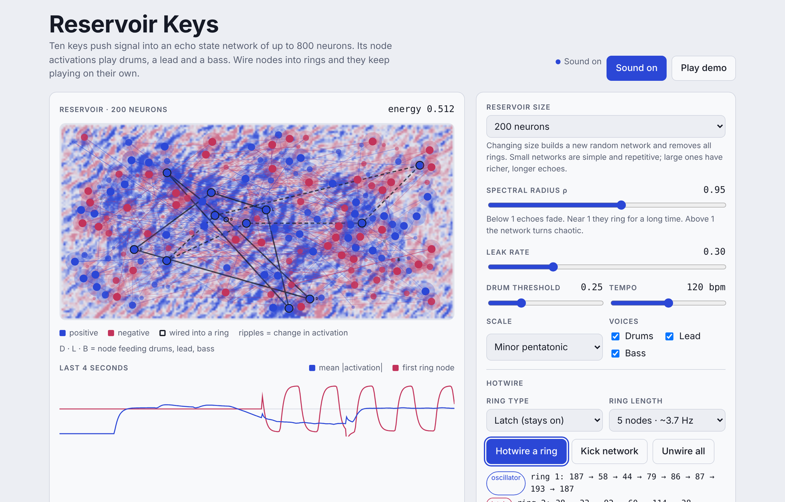

# Reservoir Keys

**Play a recurrent neural network like an instrument.**

Ten keys push signal into an echo state network. Its neurons ripple across a water surface, and their activations play drums, a lead and a bass. Wire neurons into loops and the network keeps playing on its own.

### [▶ Play it in your browser](https://melidisc.github.io/reservoir-keys/)

No install, no sign-up. Click the page once, then hold the keys **Q** to **P**.

[](https://melidisc.github.io/reservoir-keys/)

---

## What you can do

- **Play** ten input channels with the keyboard (Q to P), the mouse or touch.
- **Watch** every neuron on a simulated water surface. Ripples spread whenever a neuron's activation changes, and connections light up while signal flows through them.
- **Hotwire** random neurons into rings: oscillators that cycle forever like an LFO, or latches that switch on and stay on.
- **Shape the dynamics** live: reservoir size (50 to 800 neurons), spectral radius, leak rate, drum threshold, tempo and scale.
- **Live-code it in Python** with [Sardine](https://sardine.raphaelforment.fr/) and SuperCollider, using the same network.

## How it works

An echo state network is a recurrent network whose internal weights are random and never trained. Input disturbs it, the disturbance echoes around the network, and slowly dies out. Here those echoes are the music.

Every 10 ms each neuron updates:

```
x ← (1 − a)·x + a·tanh(ρ·W·x + W_in·u + noise)
```

| Symbol | Meaning |
|---|---|
| `x` | activation of every neuron, between −1 and 1 |
| `u` | input from the ten keys, with a fast attack and slow release |
| `W` | sparse random weights (10% connected), scaled to spectral radius 1 |
| `ρ` | spectral radius. Below 1 echoes fade, near 1 they ring, above 1 the network turns chaotic |
| `a` | leak rate. Low values give slow swells, high values fast jitter |

A sequencer reads the network on a sixteenth-note grid:

- **Drums:** three neurons for kick, snare and hi-hat. A drum hits when its neuron crosses a threshold.
- **Lead:** one neuron picks the pitch on the chosen scale, another opens the filter.
- **Bass:** one neuron sets the pitch of a filtered saw on every beat.

### Hotwiring

`hotwire` connects a few random neurons in a ring with strong weights.

- **Oscillator ring:** one connection is inhibitory, so the loop chases its own tail. Longer rings cycle more slowly (3 nodes ≈ 7 Hz, 5 ≈ 3.7 Hz, 7 ≈ 2.6 Hz, 9 ≈ 2 Hz).
- **Latch ring:** every connection is excitatory, so one push switches it on for good.

The voices then follow the ring's neurons, which turns the network from an echo chamber into a self-playing groove.

## Things to try

1. Tap one key, then hold another, and listen to how differently each echo decays.
2. Push ρ to 1.05 and play a few keys. The network starts improvising.
3. Hotwire a 9-node oscillator, then a 3-node one, and hear two rhythms interlock.
4. Hotwire a latch, then drop the leak rate to 0.1 for slow, held drones.
5. Switch to 800 neurons for longer, richer echoes, or 50 for a simple, repetitive machine.

## Live-coding it in Python

The same network runs in Python, driving [Sardine](https://sardine.raphaelforment.fr/) and SuperDirt, so you can change the music by editing code while it plays.

**Setup** (Python 3.11 in a virtual environment recommended):

```bash
python -m pip install -r requirements.txt
```

Install [SuperCollider](https://supercollider.github.io/), then run `Quarks.install("SuperDirt")` in it once.

On macOS, give your terminal *Input Monitoring* permission (System Settings → Privacy & Security) so the key listener works. On Linux under Wayland the listener may not see keys; use an X11 session.

**Play:**

```bash
sardine
```

```python
exec(open("esn_live.py").read())   # start the network and the voices
# press F8 to arm the Q..P keys, then play
hotwire()                          # two oscillator rings
hotwire(1, length=9)               # a slower ring, about 2 Hz
hotwire(1, kind="latch")           # a ring that stays on
esn.rho = 1.05                     # edge of chaos
esn.leak = 0.1                     # slower, smoother reservoir
esn.kick()                         # shove the whole network
unwire()                           # back to fading echoes
silence()                          # stop the sound
```

Edit any `@swim` function in `esn_live.py` and run it again to change the music on the next beat. `starter.py` has a few plain Sardine patterns to warm up with.

**No SuperCollider?** `python esn_offline.py` renders `esn_demo.wav` with numpy alone: a few key presses that fade, then hotwired rings taking over.

## Project layout

| Path | What it is |
|---|---|
| `docs/index.html` | the browser instrument, a single self-contained page (served by GitHub Pages) |
| `esn_core.py` | the echo state network, background runner and keyboard listener (numpy) |
| `esn_live.py` | connects the network to Sardine voices |
| `esn_offline.py` | renders a demo WAV without Sardine |
| `starter.py` | basic Sardine patterns |
| `esn_demo.wav` | example output of `esn_offline.py` |

To run the browser version locally, open `docs/index.html` in any modern browser.

## Credits

- [Sardine](https://sardine.raphaelforment.fr/) by Raphaël Forment, Python live coding
- [SuperCollider](https://supercollider.github.io/) and SuperDirt, the sound engine for the Python version
- Echo state networks were introduced by Herbert Jaeger (2001)
